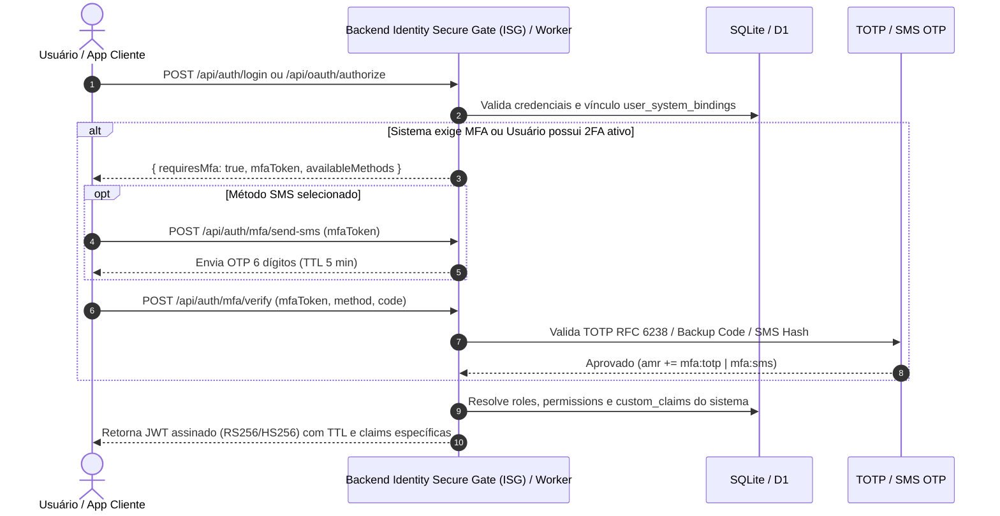
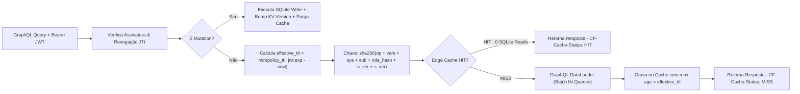
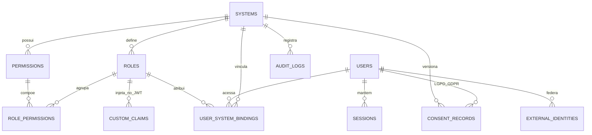

# Identity Secure Gate (ISG) — Plataforma de Identidade, OAuth 2.0, RBAC e Governança na Borda

Plataforma completa de **Identity and Access Management (IAM)** construída com **React** + **Node.js**, otimizada para **alta taxa de leitura e baixa taxa de gravação** sobre **SQLite (WAL) / Cloudflare D1**, com API **GraphQL** centralizada, **cache distribuído na borda** sensível à expiração de tokens JWT e versões de permissão, **autenticação de dois fatores (TOTP + SMS)**, federação com **provedores externos (IdPs)**, telemetria em tempo real e conformidade **LGPD / GDPR**.

---

## Índice

1. [Visão Geral e Stack Tecnológica](#visão-geral-e-stack-tecnológica)
2. [Pré-requisitos e Instalação](#pré-requisitos-e-instalação)
3. [Configuração e Variáveis de Ambiente](#configuração-e-variáveis-de-ambiente)
4. [Execução, Build e Verificação](#execução-build-e-verificação)
5. [Estrutura do Projeto](#estrutura-do-projeto)
6. [Arquitetura e Diagramas (Obsidian / Mermaid)](#arquitetura-e-diagramas-obsidian--mermaid)
7. [Sistemas e Contas Iniciais (Seed)](#sistemas-e-contas-iniciais-seed)
8. [Módulos da Interface](#módulos-da-interface)
9. [Referência de APIs e Endpoints](#referência-de-apis-e-endpoints)
10. [Deploy na Borda (Cloudflare Workers + D1 + KV)](#deploy-na-borda-cloudflare-workers--d1--kv)
11. [Segurança e Conformidade LGPD / GDPR](#segurança-e-conformidade-lgpd--gdpr)
12. [Histórico de Versões Incrementais](#histórico-de-versões-incrementais)

---

## Visão Geral e Stack Tecnológica

O **Identity Secure Gate (ISG)** centraliza autenticação, autorização e auditoria para múltiplos sistemas clientes em um único plano de controle:

| Camada | Tecnologias | Responsabilidade |
| :--- | :--- | :--- |
| **Frontend** | React 19, TypeScript, Vite 8, Tailwind CSS 4, Lucide Icons | Console administrativo e portal do titular com telas de configuração e *master/details* em modais popup |
| **Visualização** | D3.js 7, Recharts 3 | Tendência horária de usuários ativos (24h) e distribuição de códigos HTTP (`2xx`, `4xx`, `5xx`) por sistema |
| **Backend & Auth** | Node.js, Express 4, `jose` (RS256/HS256 + JWKS), `otpauth`, `qrcode` | Emissão e verificação de JWTs, OAuth 2.0 / OIDC (PKCE S256), 2FA (TOTP/SMS/Backup), federação IdP e SSE |
| **API Administrativa** | `graphql`, `dataloader` | API GraphQL única (`/graphql`) para CRUD administrativo e autoatendimento sem consultas N+1 |
| **Persistência & Cache** | `better-sqlite3` (modo WAL), EdgeCache + KV Store em memória/D1 | Leituras indexadas de baixa latência, lotes assíncronos de auditoria e invalidação imediata por versão |
| **Exportação Edge** | `jszip`, Cloudflare Workers/D1/KV Bundle | Geração de pacote pronto (`wrangler.toml`, `schema.d1.sql`, `src/worker.ts`) para deploy na Cloudflare |

---

## Pré-requisitos e Instalação

### Pré-requisitos
- **Node.js** `>= 20.x` (recomendado `v20 LTS` ou `v22 LTS`)
- **npm** `>= 10.x`
- Ferramentas de compilação C/C++ nativas caso o `better-sqlite3` precise compilar em seu sistema operacional (Python 3, `make`, `g++` no Linux ou Xcode Command Line Tools no macOS).

### Passo a Passo de Instalação

1. **Instale as dependências do projeto:**
   ```bash
   npm install
   ```

2. **Crie o arquivo de variáveis de ambiente `.env` a partir do modelo:**
   ```bash
   cp .env.example .env
   ```

3. **Ajuste os segredos obrigatórios no `.env`** (em especial `IAM_MASTER_SECRET` para produção).

4. **Inicie o servidor integrado (Backend Express + Frontend Vite HMR/Middleware):**
   ```bash
   npm run dev
   ```

Na primeira inicialização, o servidor executará automaticamente:
- A criação da pasta `./data/` e do banco SQLite em modo **WAL** (`./data/vektor-iam.sqlite`);
- A aplicação do schema relacional completo com índices de cobertura;
- A geração e persistência do par de chaves assimétricas **RSA (RS256 / JWKS)** na tabela `kv_store`;
- O *seed* inicial com 3 sistemas OAuth 2.0, roles/permissões/claims RBAC, 4 provedores externos (IdPs) e contas de demonstração.

Acesse a aplicação no navegador em **`http://localhost:3000`**.

---

## Configuração e Variáveis de Ambiente

Todas as variáveis suportadas são configuradas via arquivo `.env` ou variáveis de ambiente do processo:

| Variável | Padrão | Obrigatória | Descrição |
| :--- | :--- | :--- | :--- |
| `PORT` | `3000` | Não | Porta HTTP onde o Express e o Vite servem a aplicação (`0.0.0.0`). |
| `APP_URL` | Detectado via request | Recomendado | URL pública base da aplicação (ex.: `https://iam.sua-empresa.com`), usada no OIDC Discovery e callbacks OAuth. |
| `SQLITE_PATH` | `./data/vektor-iam.sqlite` | Não | Caminho do arquivo de banco SQLite (local ou volume persistente). |
| `IAM_JWT_ISSUER` | `https://isg.edge.local` | Recomendado | Claim `iss` assinada nos JWTs emitidos e exibida no `/.well-known/openid-configuration`. |
| `IAM_MASTER_SECRET` | Chave dev padrão | **Sim (Prod)** | Chave mestra (mín. 32 bytes) usada para criptografia **AES-256-GCM** dos segredos TOTP em repouso e assinatura interna. |
| `GOOGLE_OAUTH_CLIENT_ID` | *(vazio — modo simulado)* | Não | Client ID real do Google OAuth 2.0. Quando definido, desativa o modo simulado para Google. |
| `GOOGLE_OAUTH_CLIENT_SECRET` | *(vazio)* | Não | Client Secret do Google OAuth 2.0. |
| `GITHUB_OAUTH_CLIENT_ID` | *(vazio — modo simulado)* | Não | Client ID real do GitHub OAuth 2.0. |
| `GITHUB_OAUTH_CLIENT_SECRET` | *(vazio)* | Não | Client Secret do GitHub OAuth 2.0. |
| `NODE_ENV` | `development` | Não | Em `production`, se existir a pasta `dist/`, o Express serve os arquivos estáticos compilados em vez do middleware Vite. |

### Parâmetros de Otimização SQLite WAL Aplicados Automaticamente
O módulo de banco (`server/db.ts`) configura as seguintes diretivas na abertura da conexão:
- `journal_mode = WAL`: permite leituras concorrentes sem bloqueio durante gravações;
- `synchronous = NORMAL`: reduz latência de *fsync* mantendo segurança no modo WAL;
- `cache_size = -64000`: reserva 64 MB de cache de páginas em RAM;
- `temp_store = MEMORY` e `mmap_size = 268435456` (256 MB *memory-mapped I/O*);
- `foreign_keys = ON`: garante integridade referencial entre sistemas, usuários, roles, permissões e vínculos.

---

## Execução, Build e Verificação

| Comando | Script (`package.json`) | Finalidade |
| :--- | :--- | :--- |
| `npm run dev` | `tsx server.ts` | Inicia backend Express + middleware Vite na porta `3000` em desenvolvimento. |
| `npm run build` | `vite build` | Compila o frontend React/TypeScript para a pasta `dist/`. |
| `npm run start` | `node server.ts` | Executa o servidor em produção servindo o bundle estático de `dist/` (`NODE_ENV=production`). |
| `npm run lint` | `tsc --noEmit` | Executa verificação estrita de tipos TypeScript em frontend e backend. |
| `npm run preview` | `vite preview` | Pré-visualização isolada dos ativos compilados do Vite. |
| `npm run clean` | `rm -rf dist server.js` | Limpa artefatos de compilação anteriores. |

### Fluxo Recomendado para Produção Node.js
```bash
npm ci
npm run lint
npm run build
NODE_ENV=production PORT=3000 npm start
```

---

## Estrutura do Projeto

```text
.
├── .env.example                 # Modelo de variáveis de ambiente
├── index.html                   # Entrada HTML, fontes e metadados OpenGraph
├── package.json                 # Scripts e dependências (React, D3, Recharts, Express, SQLite, GraphQL)
├── server.ts                    # Servidor Express: Auth, OAuth 2.0/OIDC, 2FA, SSE, /graphql e Bundle CF
├── server/
│   ├── db.ts                    # Conexão SQLite WAL, schema D1, índices compostos e seed inicial
│   ├── cryptoAuth.ts            # Chaves RS256/JWKS, assinatura/validação JWT, TOTP, AES-256-GCM e PII mask
│   ├── edgeCache.ts             # Cache distribuído com TTL = min(policy_ttl, jwt.exp - now) e versionamento KV
│   ├── graphql.ts               # Schema GraphQL, DataLoaders (zero N+1), queries e mutations RBAC/LGPD
│   ├── telemetry.ts             # Hub SSE em tempo real e fila assíncrona em lote para audit_logs
│   └── cloudflareExport.ts      # Gerador de wrangler.toml, schema.d1.sql e Worker TS (.zip)
└── manager/
    ├── App.tsx                  # Layout principal, sidebar, breadcrumb, diagnósticos GraphQL e modal de sessão
    ├── hooks/
    │   └── useSessionExpiration.ts  # Hook de contagem regressiva do JWT e alerta 5 min antes de expirar
    ├── lib/
    │   └── graphqlClient.ts     # Cliente GraphQL com leitura dos headers CF-Cache-Status e métricas SQLite
    ├── types/
    │   └── iam.ts               # Tipagens TypeScript compartilhadas de domínio IAM
    └── components/
        ├── AuthGate.tsx             # Tela de login (sem auto-registro), seleção de sistema, 2FA e IdPs
        ├── OverviewTelemetry.tsx    # Estatísticas-chave, gráfico D3 (24h), gráfico Recharts HTTP, Alertas Recentes e KPIs
        ├── AuditLogs.tsx            # Tabela pesquisável e filtrável de logs de auditoria via GraphQL + CSV/SSE/Popup
        ├── SystemsManager.tsx       # CRUD de sistemas OAuth 2.0, políticas JWT/2FA e rotação de client_secret
        ├── UsersManager.tsx         # CRUD administrativo de usuários e vínculos multi-sistema
        ├── RbacClaimsManager.tsx    # Gestão de roles, permissões atômicas, claims personalizadas e preview JWT
        ├── IdpAndOAuthSandbox.tsx   # Configuração de IdPs externos em popup e Sandbox OAuth 2.0 + PKCE S256
        ├── GraphqlAndCloudflare.tsx # Explorador GraphQL ao vivo e download do pacote Cloudflare Workers/D1
        └── ProfileAndCompliance.tsx # Portal centralizado (2FA TOTP/SMS, sessões) e central LGPD/GDPR
```

---

## Arquitetura e Diagramas (Obsidian / Mermaid)

### Arquitetura Geral do Sistema

```mermaid
flowchart TB
    subgraph Client["Frontend React (Console Administrativo & Portal do Usuário)"]
        UI_AUTH["Login · 2FA Gate · Sandbox OAuth 2.0"]
        UI_ADMIN["Painel Admin (100% GraphQL CRUD)"]
        UI_PROFILE["Perfil Central (TOTP QR, SMS, Sessões, LGPD)"]
        UI_GQL["Infraestrutura · Telemetria D3/Recharts · Alertas"]
    end

    subgraph Edge["Backend Node.js & Adaptador Cloudflare Worker"]
        CACHE["Edge Cache Engine<br/>TTL = min(policy_ttl, jwt_exp - now)"]
        KV["KV Version Store<br/>u_ver:{userId} · s_ver:{systemId}"]
        AUTH["OAuth 2.0 / OIDC · JWT (RS256/HS256) · TOTP/SMS"]
        GQL["GraphQL Engine + DataLoader (Zero N+1)"]
        SSE["SSE Telemetry Hub + PII Masking (LGPD/GDPR)"]
    end

    subgraph Data["Persistência SQLite WAL / Cloudflare D1"]
        DB_READ["Índices Compostos de Cobertura<br/>(users, systems, bindings, roles, claims)"]
        DB_WRITE["Batched Async Writer<br/>(audit_logs em lote)"]
    end

    UI_AUTH --> AUTH
    UI_ADMIN -->|POST /graphql + Bearer JWT| CACHE
    UI_PROFILE -->|POST /graphql + Bearer JWT| CACHE
    UI_GQL -->|POST /graphql| CACHE
    UI_GQL <-->|GET /api/telemetry/stream| SSE

    CACHE -->|Cache HIT| UI_ADMIN
    CACHE -->|Cache MISS + KV Check| GQL
    KV -.->|Invalidação em Mutations| CACHE
    GQL -->|1 Query IN (...) por nível| DB_READ
    AUTH --> DB_READ
    SSE --> DB_WRITE
```

### Fluxo de Autenticação JWT / OAuth 2.0 + 2FA Pós-Login



### Estratégia de Cache Distribuído na Borda & Prevenção de N+1



### Modelo de Dados SQLite / Cloudflare D1



---

## Sistemas e Contas Iniciais (Seed)

> **Nota de segurança:** O auto-registro público de usuários na tela de login está **desabilitado** (`POST /api/auth/register` retorna `403 Forbidden`). Novos usuários devem ser provisionados exclusivamente por administradores na aba **Usuários** (ou via federação IdP externa quando habilitada).

### Contas de Demonstração Pré-Cadastradas

| Perfil | E-mail | Senha | 2FA Inicial | Papel Principal (`secure-gate`) |
| :--- | :--- | :--- | :--- | :--- |
| **Administrador Global** | `administrator@smarttarget.com.br` | `Vektor@2026!` | Opcional | `super_admin` (acesso total + `EdgePay` + `Atlas Analytics`) |
| **Operadora IAM** | `operator@smarttarget.com.br` | `Clara@2026!` | SMS Ativo (`+55 21 98420-1190`) | `iam_operator` |
| **Analista** | `rafael.costa@vektor.iam` | `Rafael@2026!` | Inativo | `analytics_viewer` (`Atlas Analytics`) / `gateway_developer` (`EdgePay`) |

### Sistemas OAuth 2.0 Iniciais

| Sistema | Slug | Algoritmo / TTL JWT | Edge Cache TTL | Política 2FA |
| :--- | :--- | :--- | :--- | :--- |
| **Identity Secure Gate** | `secure-gate` | `RS256` · `3600s` | `120s` | Opcional / Perfil |
| **EdgePay Gateway** | `edgepay-gateway` | `RS256` · `900s` | `45s` | **Obrigatório** |
| **Atlas Analytics** | `atlas-analytics` | `HS256` · `7200s` | `300s` | Opcional / Perfil |

---

## Módulos da Interface

- **Visão Geral (Painel Sintético + 7 Submenus Detalhados)**:
  - **Visão Geral**: consolida todas as seções em uma única página sintética com atalhos diretos (`Detalhar`) para cada submenu.
  - **Estatísticas-Chave**: contagens ao vivo e inventário completo de usuários, adoção de 2FA (TOTP/SMS) e sessões JWT ativas/expiradas.
  - **Tendência (24h)**: gráfico D3.js interativo e tabela detalhada das 24 janelas horárias de usuários, sessões e eventos.
  - **Códigos HTTP (24h)**: gráfico empilhado Recharts (`2xx`/`4xx`/`5xx`) e tabela de taxas de sucesso por sistema.
  - **Borda & SQLite WAL**: matriz completa de Edge Cache, KV Store, latências `p50`/`p95`, SQLite WAL e streams SSE.
  - **Histórico de Saúde**: transições persistidas entre *Saudável*, *Atenção* e *Crítica* com filtros por severidade.
  - **Alertas Recentes**: monitoramento em tempo real via SSE + polling com filtros por categoria (`Acesso`, `2FA`, `RBAC`) e inspetor JSON em popup.
  - **Logs de Auditoria**: tabela pesquisável e filtrável por sistema, status, categoria de ação, recurso e janela temporal, com exportação CSV UTF-8 e popup *master/details*.
- **Sistemas**: criação, edição, remoção, configuração de redirect URIs, TTL de JWT, algoritmo (`RS256`/`HS256`), obrigatoriedade de 2FA, IdPs permitidos e rotação de `client_secret` (exibição única em popup).
- **Usuários**: criação administrativa, edição, bloqueio e gerenciamento em popup de vínculos multi-sistema (`Usuário + Sistema + Role`).
- **Permissões**: catálogo de roles e permissões atômicas, configuração em popup de permissões vinculadas e claims tipadas com pré-visualização ao vivo do payload JWT emitido.
- **Provedores**: configuração em popup de Google, GitHub, OIDC genérico e Microsoft Entra ID / SAML, além de **Sandbox OAuth 2.0 + PKCE (S256)** interativo.
- **Infraestrutura**: explorador GraphQL ao vivo exibindo `CF-Cache-Status`, duração, contagem de queries SQLite e TTL restante, além de visualizador/download `.zip` do pacote Cloudflare.
- **Conformidade**: matriz de consentimento LGPD/GDPR por sistema, exportação de portabilidade JSON (SAR) e fluxo de anonimização irreversível.
- **Perfil**: dados centralizados, alteração de senha, configuração em popup de **TOTP (QR Code SVG + 8 códigos de backup)** e **SMS OTP**, método 2FA preferencial e revogação instantânea de sessões JWT ativas.
- **Aviso de Expiração de Sessão**: cronômetro contínuo no cabeçalho e modal discreto exibido **5 minutos antes** do vencimento do JWT.

---

## Referência de APIs e Endpoints

| Endpoint | Método | Autenticação | Descrição |
| :--- | :--- | :--- | :--- |
| `/api/health` | `GET` | Pública | Status do servidor, motor `sqlite-wal` e prontidão D1. |
| `/.well-known/openid-configuration` | `GET` | Pública | Documento de descoberta OpenID Connect (issuer, endpoints e claims). |
| `/.well-known/jwks.json` | `GET` | Pública | Chave pública RSA (JWK) para validação externa de tokens `RS256`. |
| `/api/public/systems` | `GET` | Pública | Lista sistemas ativos e provedores IdP disponíveis para a tela de login. |
| `/api/auth/login` | `POST` | Credenciais | Autenticação por e-mail/senha + disparo condicional de desafio 2FA (`mfaToken`). |
| `/api/auth/register` | `POST` | Bloqueado | Retorna `403 Forbidden` e registra tentativa em auditoria (`AUTH_SELF_REGISTER_BLOCKED`). |
| `/api/auth/mfa/send-sms` | `POST` | `mfaToken` | Gera e registra OTP SMS de 6 dígitos (TTL 5 min). |
| `/api/auth/mfa/verify` | `POST` | `mfaToken` | Valida código TOTP, SMS OTP ou backup code e emite o JWT final (ou libera código OAuth). |
| `/api/oauth/authorize` | `POST` | Credenciais | Emite `authorization_code` OAuth 2.0 com suporte a PKCE (`S256`) e 2FA condicional. |
| `/api/oauth/token` | `POST` | Client / PKCE | Troca `authorization_code` (validando `code_verifier`) por `access_token` JWT. |
| `/api/oauth/userinfo` | `GET` | `Bearer JWT` | Retorna claims OIDC do titular com suporte a Edge Cache. |
| `/api/auth/decode-jwt` | `POST` | Pública | Decodifica e valida assinatura JWT para o Sandbox OAuth. |
| `/api/auth/idp/:provider/url` | `GET` | Pública | Retorna modo simulado ou URL OAuth real do provedor externo. |
| `/api/auth/idp/simulate` | `POST` | Pública | Simula retorno OIDC/SAML com provisionamento JIT e desafio 2FA. |
| `/graphql` | `POST` | `Bearer JWT` | API GraphQL única para consultas e mutações administrativas e do titular. |
| `/api/telemetry/stream` | `GET` | Pública | Stream **SSE** (`Server-Sent Events`) de eventos de auditoria e alertas em tempo real. |
| `/api/cloudflare/bundle` | `GET` | Pública | Lista os arquivos gerados para Cloudflare Workers + D1 + KV. |
| `/api/cloudflare/download` | `GET` | Pública | Faz download do arquivo `.zip` completo para deploy na Cloudflare. |

---

## Deploy na Borda (Cloudflare Workers + D1 + KV)

Você pode exportar o pacote pronto diretamente pela aba **Infraestrutura** (**Baixar Pacote .ZIP**) ou via `GET /api/cloudflare/download`. Após extrair o pacote:

1. **Crie o banco D1 na Cloudflare:**
   ```bash
   npx wrangler d1 create isg-d1
   ```

2. **Aplique o schema SQL otimizado com índices de cobertura:**
   ```bash
   npx wrangler d1 execute isg-d1 --file=./schema.d1.sql
   ```

3. **Crie o namespace Workers KV para versionamento de permissões e revogação instantânea de JTI:**
   ```bash
   npx wrangler kv namespace create IAM_KV
   ```

4. **Atualize os IDs gerados (`database_id` e `id` do KV) no arquivo `wrangler.toml` e configure o segredo de assinatura:**
   ```bash
   npx wrangler secret put JWT_HMAC_FALLBACK
   ```

5. **Publique o Worker na borda global:**
   ```bash
   npx wrangler deploy
   ```

---

## Segurança e Conformidade LGPD / GDPR

- **Armazenamento de Credenciais e Segredos**: senhas com hash criptográfico salgado e segredos TOTP cifrados em repouso com **AES-256-GCM** derivado de `IAM_MASTER_SECRET`.
- **Bloqueio de Auto-Registro**: criação de usuários restrita ao controle administrativo, evitando cadastros não autorizados diretamente na tela de login.
- **Invalidacão Consciente de Contexto**: qualquer alteração de role, permissão, vínculo ou política incrementa imediatamente `perm_version` (`u_ver`) / `policy_version` (`s_ver`), invalidando entradas anteriores no Edge Cache sem esperar a expiração do TTL.
- **Mascaramento de PII**: e-mails e endereços IP são mascarados antes da persistência e transmissão em `audit_logs` e no stream SSE.
- **Direitos do Titular**: consentimento granular versionado por sistema, portabilidade estruturada em JSON e anonimização irreversível preservando a integridade da trilha de auditoria.

---

## Histórico de Versões Incrementais

### v0.1.0 — Núcleo Backend Node.js, SQLite WAL, GraphQL Otimizado e Exportação Cloudflare D1
- Implementação da camada SQLite em modo `WAL` (`synchronous=NORMAL`, `mmap_size=256MB`, `cache_size=64MB`) com índices compostos de cobertura e escritor assíncrono em lote para `audit_logs`.
- Criação do motor `EdgeCache` com versionamento KV (`u_ver` / `s_ver`) e cálculo estrito de `effective_ttl = min(policy_ttl, jwt.exp - now)`.
- Implementação da API `/graphql` com `DataLoader` em escopo de requisição, CRUD completo de sistemas, usuários, roles, permissões e claims, além de mutações de autoatendimento 2FA e LGPD.
- Criação dos endpoints OAuth 2.0 / OIDC (`/api/oauth/authorize`, `/api/oauth/token`, `/api/oauth/userinfo`, `/.well-known/jwks.json`), fluxo 2FA pós-login (`/api/auth/mfa/verify`) e gerador do pacote Cloudflare Workers + D1.

### v0.2.0 — Console Administrativo React, Fluxo 2FA Interativo, Sandbox OAuth e Portal LGPD/GDPR
- Construção da interface escura de alta precisão (`#090D16` / `#111827` / `#F6821F`) com tipografia tabular (`Plus Jakarta Sans`, `DM Sans`, `JetBrains Mono`).
- Comunicação 100% via GraphQL para todo o CRUD administrativo (Sistemas OAuth 2.0, Usuários, Vínculos Multi-Sistema, Roles, Permissões, Claims e IdPs Externos) com barra de diagnóstico ao vivo (`CF-Cache-Status`, duração e número de consultas SQLite).
- Integração completa de 2FA (TOTP com QR Code SVG + códigos de backup e verificação por SMS OTP) no portal centralizado do usuário e no gate pós-login JWT/OAuth 2.0.
- Adição de relatório de atividades em tempo real via SSE + inspetor JSON estruturado, Explorador GraphQL interativo, download `.zip` do pacote Cloudflare Workers/D1 e painel de conformidade LGPD/GDPR (consentimentos, portabilidade JSON e anonimização).

### v1.0.0 — Verificação de Build, Tipagem TypeScript e Testes de Integração na Borda
- Validação de compilação (`vite build`) e verificação estrita de tipos (`tsc --noEmit`) sem erros.
- Verificação em execução dos endpoints `/api/health`, `/.well-known/jwks.json`, `/api/auth/login`, desafio 2FA (`/api/auth/mfa/send-sms` e `/api/auth/mfa/verify`), `/graphql` (`MISS` com 3 queries em lote via DataLoader -> `HIT` com 0 leituras SQLite e TTL limitado ao `exp` do JWT) e geração do pacote Cloudflare D1/Worker.

### v1.1.0 — Consolidação da Identidade Oficial "Smarties Gate" e Alinhamento dos Artefatos
- Padronização oficial da marca **Smarties Gate** na interface React, título HTML, emissor TOTP/JWT, pacote exportável Cloudflare Workers/D1 e documentação principal (`README.md` e plano de implementação com diagramas Mermaid compatíveis com Obsidian).

### v1.2.0 — Telas de Configuração 100% em Popups Modais
- Conversão de todas as telas de configuração anteriormente renderizadas inline para modais popup dedicados (`fixed inset-0 z-50`), mantendo as visões principais focadas em inspeção e leitura:
  - **Provedores Externos (IdPs)**: formulário de edição de provedor (Google, GitHub, OIDC genérico, Entra ID/SAML) exibido em popup modal.
  - **RBAC, Permissões e Claims**: criação de roles, criação de permissões atômicas e editor de permissões + claims personalizadas convertidos em modais popup, deixando a tela principal em modo catálogo + pré-visualização ao vivo do payload JWT.
  - **Perfil Centralizado & 2FA**: edição de perfil, alteração de senha, configuração de App Autenticador TOTP (QR Code + códigos de backup), configuração de SMS OTP e método 2FA preferencial migrados para modais popup.
  - **Sistemas OAuth 2.0**: exibição única de `client_secret` rotacionado exibida em modal popup dedicado.

### v1.3.0 — AuditLogManager, Estatísticas-Chave e Alerta de Expiração de Sessão
- Criação do componente **`AuditLogManager`** na aba de Visão Geral com tabela pesquisável e filtrável por sistema, status (`success`, `denied`, `error`) e categoria de ação via GraphQL + stream SSE, com inspeção detalhada do evento em popup modal (padrão *master/details* em popup).
- Adição do widget **Estatísticas-Chave (Key Statistics)** no topo de `OverviewTelemetry` exibindo contagens ao vivo de **Usuários Ativos**, **Tokens JWT Válidos** e **Alertas de Segurança Recentes** via consultas GraphQL existentes.
- Implementação do hook **`useSessionExpiration`** que calcula o tempo restante do token JWT e exibe um modal discreto e não intrusivo 5 minutos antes da expiração da sessão.
- Padronização do rótulo **"Criar Sistema"** no gerenciador de sistemas.

### v1.4.0 — Gráfico D3 de Tendência (24h) e Rótulos Concisos de Navegação
- Adição de gráfico de linha interativo com **D3.js** (`d3.scaleTime`, `d3.scaleLinear`, `d3.line`, `d3.area` e tooltip tabular) no `OverviewTelemetry` exibindo a tendência horária de usuários ativos, sessões ativas e eventos nas últimas 24 horas com diagnósticos GraphQL (`CF-Cache-Status`, duração e leituras SQLite).
- Simplificação dos itens do menu lateral para **Visão Geral**, **Sistemas**, **Usuários**, **Permissões**, **Provedores**, **Infraestrutura**, **Conformidade** e **Perfil**.

### v1.5.0 — Distribuição de Códigos HTTP (2xx, 4xx, 5xx) com Recharts e Títulos Refinados
- Adição do widget **Códigos HTTP por Sistema (Últimas 24h)** em `OverviewTelemetry` utilizando **Recharts** (`ResponsiveContainer`, `BarChart` empilhado) para visualizar respostas `2xx`, `4xx` e `5xx` entre todos os sistemas monitorados.
- Refinamento dos títulos das seções e rótulos de ação (**Salvar**, **Atualizar**, **Aplicar**).

### v1.6.0 — Lista de Alertas Recentes em Tempo Real (SSE + Polling)
- Adição da lista **Alertas Recentes** na aba **Visão Geral** monitorando em tempo real (via stream SSE `/api/telemetry/stream` combinado com polling GraphQL a cada 10 segundos) tentativas de acesso não autorizadas e falhas de 2FA, notificando o administrador instantaneamente e oferecendo inspeção detalhada em popup modal.

### v1.7.0 — Bloqueio de Auto-Registro de Usuários no Login
- Remoção do fluxo de cadastro público ("Registrar") da tela de login (`AuthGate`) e bloqueio da rota `POST /api/auth/register` (`403 Forbidden` com auditoria `AUTH_SELF_REGISTER_BLOCKED`), restringindo a criação de novas contas ao provisionamento administrativo via GraphQL.

### v1.8.0 — Atualização da Marca para "Smarties Secure Gate" e Textos da Tela de Login
- Atualização da identidade visual e nominal da plataforma para **Smarties Secure Gate** no console React, título HTML/OpenGraph, emissor TOTP/JWT, sistema core e pacote exportável Cloudflare Workers/D1.
- Refinamento dos textos da tela de autenticação (`AuthGate`): subtítulo alterado para **"Gerenciamento de Controle de Acesso"**, instrução para **"Selecione o sistema e o usuário para validar a identidade."** e rótulo de seleção para **"Sistema"**.

### v1.9.0 — Revisão Ortográfica, Tradução e Padronização de Textos nos Componentes
- Correção de acentuação em mensagens de autenticação/2FA/IdP (`AuthGate`) e atualização das referências remanescentes para **Smarties Secure Gate**.
- Remoção do sufixo `"via GraphQL"` em botões de modais (`Criar Sistema`, `Criar Role`, `Salvar`, `Criar Usuário`), padronização de ações (`Remover Usuário`) e atualização do texto de função padrão para novos usuários.
- Tradução integral de rótulos em inglês da interface (`Sucesso`, `Negado`, `Erro`, `Ativo`, `Bloqueado`, `Versões KV e Lotes de Auditoria`, `Atualização ao vivo`, `Emissor`, `Escopos`, `Produção`) e alinhamento dos títulos de **Provedores de Identidade** e **Infraestrutura e Borda**.

### v1.10.0 — Documentação Detalhada do Sistema, Configuração e Instalação no README
- Expansão completa do `README.md` com guia de pré-requisitos e instalação passo a passo, tabela de variáveis de ambiente (`.env`), diretivas SQLite WAL, comandos de execução/build/lint, árvore detalhada do projeto, credenciais/sistemas iniciais, referência completa de endpoints REST/OIDC/GraphQL/SSE, guia de deploy Cloudflare Workers + D1 + KV e diretrizes de segurança/LGPD, mantendo os diagramas Mermaid compatíveis com Obsidian e o histórico incremental no final.

### v1.11.0 — Novo Componente `AuditLogs` para Trilha de Auditoria via GraphQL
- Criação do componente **`AuditLogs`** (`/src/components/AuditLogs.tsx`) substituindo o gerenciador anterior na visão administrativa (**Visão Geral**), com busca textual ampla (incluindo `detailsJson`), filtros por sistema, status, categoria de ação, tipo de recurso, janela de tempo (`1h`, `24h`, `7d`, todos) e limite GraphQL (`50`, `100`, `200`), ordenação por horário/duração, resumo tabular por status, exportação CSV, atualização em tempo real via SSE e modal popup *master/details* com cópia de JSON.

### v1.12.0 — Aba Dedicada "Audit Logs" no Menu de Administração
- Adição do item **Audit Logs** em `NAV_ITEMS` (`src/App.tsx`) no grupo de Administração GraphQL, renderizando diretamente o componente **`AuditLogs`** no viewport ativo ao selecionar a aba.

### v1.13.0 — Refinamento dos Textos da Tela de Login
- Atualização da chamada principal e instruções em `AuthGate`: subtítulo alterado para **"Controle de Acesso"**, título principal para **"Identidade Digital"** e descrição para **"Selecione o sistema e informe as credenciais do usuário para validar a identidade."**.

### v1.14.0 — Tela de Configurações do Sistema (Admin-Only), Ambiente de Execução e Painel Único no Login
- **Configurações do Sistema (`SystemSettings`)**: nova aba **Configurações** restrita exclusivamente ao administrador (`super_admin` no menu lateral, viewport e resolvers GraphQL `systemSettings`, `updateSystemSettings`, `resetSystemSettings`), com persistência em SQLite (`system_settings`) cobrindo todos os parâmetros globais de Ambiente & Plataforma, JWT & OAuth 2.0, Segurança & 2FA, Edge Cache & Auditoria e LGPD & Privacidade.
- **Ambiente de Execução (`Desenvolvimento` / `Homologação` / `Produção`)**: adicionado parâmetro global inicializado em **Desenvolvimento**; quando definido para **Produção**, o painel **Contas de Demonstração** e o preenchimento automático de credenciais de teste são removidos da tela de login.
- **Painel Único "Identidade Digital"**: fusão integral do conteúdo de **Entrar no Console IAM** dentro do painel **Identidade Digital** (`AuthGate`), exibindo e-mail, senha, botão de autenticação e provedores externos logo após o seletor **Sistema**.

### v1.15.0 — Refinamento Completo do Painel Único de Login (`AuthGate`)
- Remoção do resumo de propriedades imediatamente abaixo do seletor **Sistema**, exibindo os campos **Usuário** e **Senha** e o botão **Autenticar** logo em seguida.
- Simplificação do título dos provedores externos para **Provedores de Identidade**, seguida de separador horizontal, exibição em laranja do ambiente ativo (`Ambiente: {AMBIENTE}`) e tabela estruturada linha a linha com **Sistema Alvo**, **Algorítimo de Assinatura**, **Expiração do Token**, **Expiração do Cache** e **Autenticação de 2 Fatores**.
- Inclusão de novo separador horizontal com a seção **Contas Rápidas** (`"Selecione uma conta abaixo para preencher as credenciais de acesso no ambiente de {AMBIENTE}."`) e botões de preenchimento rápido dentro do mesmo painel único (mantida a ocultação automática no ambiente **Produção**).

### v1.16.0 — Ajuste no Combo "Sistema" e Rodapé da Tela de Login
- Atualização do combo **Sistema** (`AuthGate`) para exibir exclusivamente o nome amigável do sistema, omitindo o slug entre parênteses.
- Substituição do texto do rodapé da tela de login para **`™》Smart Target, 2026`**.

### v1.17.0 — Indicador de Saúde do Sistema na Barra Superior e Refinamentos de Login/Configurações
- **Indicador "Saúde do Sistema" (`useSystemHealth` + `App`)**: exibição na barra superior, ao lado do diagnóstico `CF`, de ícone semântico verde (`< 100ms`), amarelo (`100–299ms`) ou vermelho (`≥ 300ms`) com leitura tabular da latência média calculada a partir dos logs de auditoria recentes via GraphQL (`auditLogs` / `systemHealth`) e atualizada em tempo real via stream SSE (`/api/telemetry/stream`).
- **Combo Editável de Usuário e Tabela Compacta (`AuthGate`)**: conversão do campo **Usuário** em combobox híbrido (contas rápidas ou entrada manual com senha somente leitura para contas rápidas), tabela de metadados sem bordas internas com rótulo **Sistema Selecionado** e rodapé `© 2026, Smart Target`.
- **Navegação e Abas (`App` / `SystemSettings`)**: renomeação do item de auditoria para **Auditoria** e organização da tela de configurações em abas estruturadas (`role="tablist"`).

### v1.18.0 — Sidebar Colapsável, Modo Expandido, Sparkline, Histórico de Saúde, Alertas Sonoros e Migração de Dados
- **Navegação & Foco (`App`)**: botão de colapsar/expandir sidebar (`PanelLeftClose`/`PanelLeftOpen`), modo **Expandir** (`Maximize2`/`Minimize2`) na barra superior para ocultar a barra lateral e centralizar o conteúdo, além de atalhos globais de teclado (`g` + tecla de seção) e variantes semânticas de notificação (`success`, `warning`, `error`).
- **Tendência & Histórico de Saúde (`LatencySparkline`, `HealthHistoryPanel`, `healthAlertAudio`)**: sparkline dos últimos 10 minutos no indicador de **Saúde do Sistema**, tabela `system_health_events` persistindo transições entre `healthy`/`degraded`/`critical` via SSE (`health_transition`) e GraphQL (`systemHealthHistory`), e alerta sonoro configurável (`healthAlertSoundEnabled`) em **Configurações**.
- **Auditoria & Telemetria (`AuditLogs`, `OverviewTelemetry`)**: persistência de filtros em sessão, busca por nome/e-mail real via diretório `actorDirectory`, exportação CSV com BOM UTF-8, intervalo de atualização configurável (`10s`, `30s`, `1min`, `Desativado`).
- **Atualização de Dados Iniciais (`server/db.ts`, `AuthGate`)**: migração automática dos sistemas para **Secure Gate** (`secure-gate`), **EdgePay Gateway** (`edgepay-gateway`) e **Atlas Analytics** (`atlas-analytics`) e das contas administrativas/operacionais para `administrator@smarttarget.com.br` e `operator@smarttarget.com.br`.

### v1.19.0 — Identity Secure Gate (ISG), Submenus Detalhados na Visão Geral, Painel Sintético e Tooltips
- **Rebranding Oficial para "Identity Secure Gate" (`ISG`)**: atualização do nome oficial e acrônimo **ISG** na interface React (`App`, `AuthGate`), título HTML/OpenGraph (`index.html`), emissores JWT/TOTP (`https://isg.edge.local`), pacote exportável Cloudflare Workers/D1 (`isg-edge-worker`, `isg-d1`, `isg-cloudflare-d1-bundle.zip`), sistema core no SQLite e migração automática em `server/settings.ts`.
- **Visão Geral Sintética + 7 Submenus Detalhados (`OverviewTelemetry`, `App`)**: conversão das seções de **Visão Geral** em submenus expansíveis na barra lateral (**Estatísticas-Chave**, **Tendência (24h)**, **Códigos HTTP (24h)**, **Borda & SQLite WAL**, **Histórico de Saúde**, **Alertas Recentes** e **Logs de Auditoria**) com visões de máximo detalhamento (inventário de usuários/2FA, tabela horária de 24 pontos, matriz completa de cache/SQLite, filtros por categoria) e página **Visão Geral** compacta/sintética reunindo todas as seções com botões de detalhamento direto.
- **Subtítulos Descritivos em Tooltips (`InfoTooltip`)**: criação do componente acessível `InfoTooltip` e substituição dos subtítulos descritivos estáticos nos cabeçalhos dos módulos por tooltips interativos acionáveis por foco, hover ou clique.
